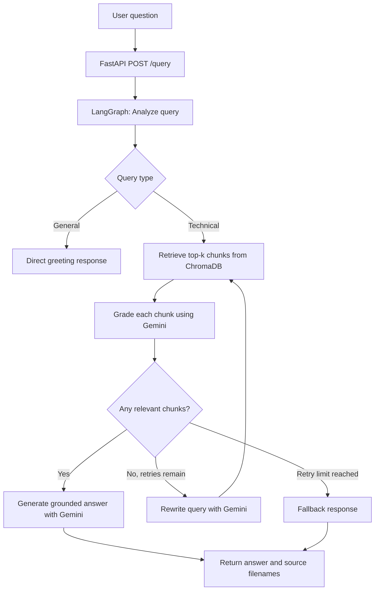
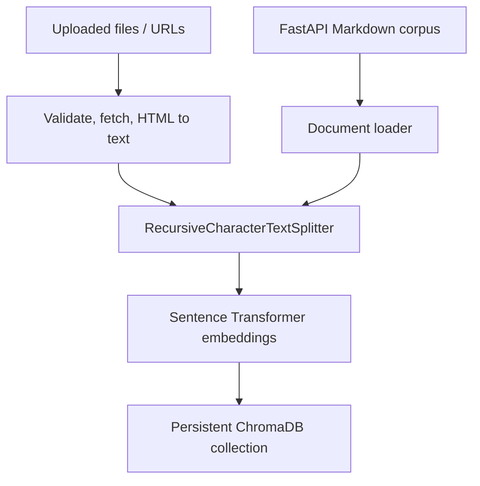

# Technical Documentation Assistant

A Retrieval-Augmented Generation (RAG) application that answers
questions using a curated corpus of FastAPI documentation. The
application uses LangGraph to coordinate query analysis, semantic
retrieval, relevance grading, query rewriting, and grounded answer
generation. FastAPI exposes the workflow through REST endpoints.

## 1. Project Overview

The goal is to build a technical documentation assistant that answers
questions from a defined documentation corpus rather than relying only
on a language model's parametric knowledge.

### Main capabilities

-   Load a local corpus of Markdown documentation.
-   Ingest additional documents from file uploads or URLs.
-   Split source documents into overlapping text chunks.
-   Generate local sentence-transformer embeddings.
-   Store and retrieve vectors using persistent ChromaDB.
-   Grade each retrieved chunk using Gemini to determine its relevance to the user's question.
-   Rewrite the search query and retry retrieval when no chunks pass the
    relevance threshold.
-   Generate an answer with Gemini using the retrieved context.
-   Return source filenames with the answer.
-   Handle simple greetings without running document retrieval.
-   Store user feedback in SQLite.
-   Expose functionality through FastAPI endpoints.

## 2. Architecture

### Query workflow



### Ingestion workflow



### Component responsibilities

- **FastAPI:** Provides HTTP endpoints for document ingestion, querying, document listing, and feedback management.
- **LangGraph:** Defines the stateful RAG workflow and conditional routing between retrieval, relevance grading, query rewriting, answer generation, and fallback.
- **Document loader and chunker:** Load the Markdown documentation corpus and split it into manageable overlapping chunks.
- **Sentence Transformers:** Generate document embeddings locally using `all-MiniLM-L6-v2`.
- **ChromaDB:** Persist document embeddings, text, and source metadata; retrieve candidate chunks using vector similarity search.
- **Relevance grader:** Uses Gemini to evaluate each retrieved chunk against the user's question and filters out irrelevant chunks.
- **Gemini:** Performs relevance grading, query rewriting, and grounded answer generation.
- **SQLite:** Persists user feedback records.

## 3. Technology Stack

  Area                     Technology
  ------------------------ ------------------------------------------
  Language                 Python
  API framework            FastAPI
  Workflow orchestration   LangGraph
  LLM                      Google Gemini
  Embedding model          `sentence-transformers/all-MiniLM-L6-v2`
  Vector database          ChromaDB
  Feedback database        SQLite
  Testing                  pytest, FastAPI TestClient

## 4. Repository Structure

``` text
Technical-Doc-Assistant/
├── app/
│   ├── database/
│   │   ├── feedback_store.py
│   │   ├── retriever.py
│   │   └── vector_store.py
│   ├── ingestion/
│   │   ├── chunker.py
│   │   ├── indexer.py
│   │   ├── loader.py
│   │   └── sources.py
│   ├── rag/
│   │   ├── generator.py
│   │   ├── graph.py
│   │   ├── nodes.py
│   │   ├── state.py
│   │   └── test_graph.py
│   ├── tests/
│   │   ├── test_api.py
│   │   ├── test_ingest.py
│   │   └── test_llm.py
│   ├── api.py
│   ├── config.py
│   ├── llm.py
│   ├── main.py
│   └── schemas.py
├── documents/
│   └── fastapi/
│       ├── body.md
│       ├── dependencies.md
│       ├── first-steps.md
│       ├── path-params.md
│       └── query-params.md
├── .env.example
├── .gitignore
├── requirements.txt
└── README.md
```

The `documents/fastapi/` directory is the document corpus used by this
project. It contains five Markdown files covering FastAPI first steps,
path parameters, query parameters, request bodies, and dependencies.
Keep these files in the repository so the application can be ingested
locally.

Runtime artifacts such as `venv/`, `.env`, `chroma_db/`, and
`feedback.db` should not be committed.

## 5. Setup Instructions

### Prerequisites

-   Python 3.10 or newer. The project was developed and tested with
    Python 3.14.7.
-   A Google Gemini API key.
-   Internet access for Gemini requests and the initial
    sentence-transformer model download.

### 1. Clone the repository

``` bash
git clone https://github.com/SovikMandal/Technical-Doc-Assistant.git
cd Technical-Doc-Assistant
```

### 2. Create and activate a virtual environment

**Windows PowerShell**

``` powershell
python -m venv venv
.\venv\Scripts\Activate.ps1
```

**macOS / Linux**

``` bash
python -m venv venv
source venv/bin/activate
```

### 3. Install dependencies

``` bash
python -m pip install --upgrade pip
python -m pip install -r requirements.txt
```

### 4. Configure environment variables

Copy `.env.example` to `.env` and add your own Gemini API key.

``` env
GEMINI_API_KEY=your_gemini_api_key_here
GEMINI_MODEL=gemini-3.5-flash-lite
```

Never commit `.env` or expose your API key. The `.env.example` file
documents the required variable names without containing secrets.

## 6. Run the Application

Finish the Setup Instructions above first. Then follow these steps.
### Step 1: Start the server

``` bash
uvicorn app.main:app --reload
```

Wait until you see `Application startup complete`. Keep this terminal
open while you use the app.

### Step 4: Open the API in your browser

Go to <http://127.0.0.1:8000/docs>. This page (Swagger UI) lets you try
every endpoint without writing any code.

### Step 5: Load the documents (first time only)

In Swagger UI, open `POST /ingest`, click **Try it out**, then
**Execute**. Leave all fields empty to load the built-in FastAPI
documents.

Or use curl from a second terminal:

``` bash
curl -X POST "http://127.0.0.1:8000/ingest"
```

The first run downloads the embedding model, so it can take a minute.
You only need to do this once. The index is saved in `chroma_db/` and
is reused the next time you start the server.

### Step 6: Ask a question

In Swagger UI, open `POST /query`, click **Try it out**, enter a
question, and click **Execute**:

``` json
{
  "question": "How do I define query parameters in FastAPI?"
}
```

The response contains the answer and the source files it came from.

### Stop the server

Press `Ctrl + C` in the terminal where the server is running.

### Common problems

| Problem | Fix |
|---|---|
| `GEMINI_API_KEY is missing from .env` | Copy `.env.example` to `.env` and add your Gemini API key (Setup step 4). |
| `uvicorn` is not recognized | The virtual environment is not active. Repeat Step 2. |
| `Activate.ps1 cannot be loaded because running scripts is disabled` | Run `Set-ExecutionPolicy -Scope CurrentUser RemoteSigned` once in PowerShell, then repeat Step 2. |
| `/query` always says it could not find information | The documents are not loaded yet. Do Step 5. |
| `pip install -r requirements.txt` cannot read the file | The file must be UTF-8. If you regenerate it in PowerShell, use `python -m pip freeze \| Out-File -Encoding utf8 requirements.txt`. |
| You want to rebuild the index from scratch | Stop the server, delete the `chroma_db/` folder, start the server again, and repeat Step 5. |

## 7. API Endpoints and Examples

### `GET /`

Checks whether the API is running.

Example response:

``` json
{
  "message": "Technical Documentation Assistant API is running"
}
```


### `POST /ingest`

Ingests new documents from file uploads and/or URLs, sent as
`multipart/form-data`. Each document is chunked, embedded, and stored in
the persistent ChromaDB collection.

| Form field | Type | Description |
|---|---|---|
| `files` | file, repeatable | `.md`, `.markdown`, or `.txt` files, UTF-8, max 5 MB each |
| `urls` | string, repeatable | Public `http`/`https` URLs of HTML pages or text/Markdown files, max 5 MB each. One field may also hold several URLs separated by commas or newlines |

Behavior:

- If the request contains no files and no URLs, the predefined local
  corpus (`documents/fastapi/`) is ingested.
- A request may contain up to 10 files and URLs combined.
- Uploaded files are cited by filename and URLs by the submitted URL.
  Re-ingesting the same filename or URL replaces its previous chunks.
- HTML pages are converted to plain text; scripts and styles are removed.
- All items are validated before anything is indexed. If any item fails,
  the request is rejected and the index is unchanged.
- URLs that resolve to private, loopback, link-local, or other
  non-public addresses are rejected, including after redirects.

**Examples using curl:**

```bash
# Ingest the local corpus
curl -X POST "http://127.0.0.1:8000/ingest"

# Upload files and add a URL
curl -X POST "http://127.0.0.1:8000/ingest" \
  -F "files=@notes.md" \
  -F "files=@guide.txt" \
  -F "urls=https://fastapi.tiangolo.com/tutorial/cors/"
```

**Example response:**

```json
{
  "message": "Documents ingested successfully",
  "ingested": [
    {"source": "notes.md", "source_type": "file", "chunks": 1},
    {
      "source": "https://fastapi.tiangolo.com/tutorial/cors/",
      "source_type": "url",
      "chunks": 15
    }
  ],
  "total_chunks": 85
}
```

`source_type` is `corpus`, `file`, or `url`. Chunk counts are
illustrative.

**Errors:** `400` empty or non-UTF-8 file, `413` file or page too large,
`415` unsupported file or content type, `422` invalid, private, or
duplicate URL, or too many items, `502` URL returned an error, `504` URL
fetch timed out.

### `GET /documents`

Returns indexed source filenames and the number of chunks associated
with each source.

### `POST /query`

Submits a question to the LangGraph RAG workflow.

Example request:

``` json
{
  "question": "How do I define query parameters in FastAPI?"
}
```

Example response shape:

``` json
{
  "question": "How do I define query parameters in FastAPI?",
  "answer": "Answer grounded in the retrieved documentation, with source filename citations.",
  "sources": [
    "query-params.md"
  ]
}
```

If no relevant documentation is found after the configured retries, the
API returns a fallback answer and an empty `sources` list.

### `POST /feedback`

Stores feedback for a question and its generated answer. The rating must
be between 1 and 5.

Example request:

``` json
{
  "question": "How do query parameters work?",
  "answer": "Example generated answer",
  "rating": 5,
  "feedback": "Helpful explanation"
}
```

### `GET /feedback`

Returns stored feedback records.

> The feedback endpoints are intended for this local assignment
> implementation. Add authentication and access controls before exposing
> them publicly.

## 8. Design Decisions, Thought Process, and Trade-offs

### Why RAG and LangGraph?

The task is to answer questions grounded in a supplied technical corpus.
RAG provides a retrieval step so the model receives relevant source text
at answer time. LangGraph makes the workflow explicit: each operation is
a node, and conditional edges decide whether to generate, rewrite and
retry, or return a fallback.

This separates retrieval and relevance decisions from answer generation.
It also makes the retry limit explicit and testable.

### Why local embeddings and ChromaDB?

The project uses `sentence-transformers/all-MiniLM-L6-v2` to generate
embeddings locally. This avoids an additional paid embedding API call
and keeps embedding generation independent of Gemini availability. The
trade-off is that the embedding model must be downloaded and run
locally, which uses local disk, memory, and compute.

ChromaDB was selected as a lightweight persistent vector store that is
straightforward to run locally for a small documentation corpus. Its
local persistence means the index can be reused between application
runs.

### Chunking strategy

The current implementation uses `RecursiveCharacterTextSplitter` with:

-   **Chunk size:** 800 characters
-   **Chunk overlap:** 150 characters
-   **Separators:** paragraph breaks, line breaks, spaces, then
    individual characters

The intent is to keep chunks small enough for focused retrieval while
retaining nearby context across chunk boundaries. The overlap reduces
the chance that a concept split at a boundary loses necessary context.
The trade-off is some repeated text and a larger vector index.

These values are initial engineering choices, not the result of a formal
benchmark. They should be evaluated against a representative set of
questions and adjusted based on retrieval quality.

### Retrieval and relevance grading

The retriever requests the top 4 chunks (`TOP_K = 4`) from ChromaDB using vector similarity search. This initial retrieval identifies candidate documents but does not determine their final relevance.

Gemini receives the original user question and all retrieved chunks, including their source filenames and content. It evaluates each chunk independently and returns structured JSON containing the chunk index, a boolean relevance decision, and a short explanation.

The application validates the grading response and retains only the chunks marked as relevant. If no relevant chunks are found, the workflow proceeds to query rewriting and retries retrieval, subject to the configured retry limit.

**Trade-offs:** LLM-based relevance grading provides context-aware decisions compared with a fixed similarity threshold. However, it introduces additional Gemini API usage, response latency, and the possibility of invalid model responses. The grading accuracy has not yet been benchmarked against a human-labelled relevance dataset.

### Self-correction and retry limit

When no retrieved chunk passes the relevance threshold, the workflow
asks Gemini to rewrite the search query and retrieves again.
`MAX_RETRIES = 2` bounds the number of rewrites. A bounded retry avoids
infinite loops and limits latency and API usage. If the retry limit is
reached without relevant evidence, the workflow returns a fallback
response instead of inventing an answer.

### General-query routing

Simple greetings and a small set of conversational messages are handled
with deterministic rules. They do not need document retrieval or an LLM
call. Other messages proceed through retrieval and relevance grading;
therefore, an unrelated factual question should receive a
documentation-based fallback rather than being treated as a greeting.

### Answer generation and citations

Gemini receives the user's question and the relevant chunks, with
instructions to answer only from the supplied documentation and cite
source filenames. The API separately returns the source filenames as
metadata.

The current citation behavior is prompt-guided. Generated citation
claims are not yet independently validated against the source chunks, so
citation verification remains an improvement area.

## 9. Assumptions

-   The supplied corpus is the source of truth for technical answers.
    The assistant should not fill missing documentation with unsupported
    outside knowledge.
-   The current corpus is a small, curated FastAPI subset, not the
    complete FastAPI documentation.
-   The application is primarily intended to run locally for evaluation,
    rather than as a multi-user production service.
-   A single Gemini API key is configured through environment variables.
-   The selected chunking and similarity settings are starting values
    that require evaluation rather than universal optimal settings.

## 10. Tests

Run the full automated test suite from the repository root:

``` bash
python -m pytest -v
```

The current suite contains 46 tests covering:

-   Successful LangGraph retrieval and generation routing.
-   Query rewriting and retry behavior.
-   Retry exhaustion and fallback behavior.
-   General-query routing without retrieval.
-   API root, query, and request validation behavior.
-   Gemini API error-to-HTTP-status mapping.
-   Successful and empty Gemini responses.
-   Document ingestion from file uploads and URLs: file type, size, and
    encoding checks, HTML-to-text conversion, URL errors and timeouts,
    blocking of private addresses (including after redirects), and
    replacement of a source's chunks on re-ingestion.

Most workflow and API tests use mocks. They validate application logic
without requiring live Gemini requests. They do not replace end-to-end
tests against the actual embedding model, ChromaDB index, and Gemini
service.

## 11. Improvements With More Time

1.  **Evaluate retrieval systematically:** Build a labeled
    question-to-source test set and measure retrieval precision/recall.
    Tune chunk size, overlap, `TOP_K`, and the similarity threshold
    using those results.
2.  **Validate citations:** Verify that every cited filename was
    actually retrieved and that the cited chunk supports the associated
    claim.
3.  **Improve query understanding:** Expand query classification and
    rewriting tests, including ambiguous and multi-part questions.
4.  **Add answer-quality checks:** Evaluate faithfulness and
    completeness against retrieved context, with a safe fallback when
    the answer is unsupported.
5.  **Improve observability:** Record retrieval scores, retry counts,
    model latency, and failures without logging secrets or unnecessary
    personal data.
6.  **Harden the API:** Add authentication, rate limiting, request-size
    limits, and access controls for feedback endpoints before public
    deployment.
7.  **Improve deployment readiness:** Add containerization, structured
    configuration, health checks, and a managed database/vector store if
    the application needs to scale.

## 12. Security Notes

-   Keep API keys in `.env`; commit only `.env.example`.
-   Do not commit `venv/`, `chroma_db/`, or `feedback.db`.
-   Add authentication, rate limiting, and suitable access controls
    before public deployment.
-   Review feedback access and retention before storing real user data.

## License

This project is licensed under the MIT License.
See the [LICENSE](LICENSE) file for details.
